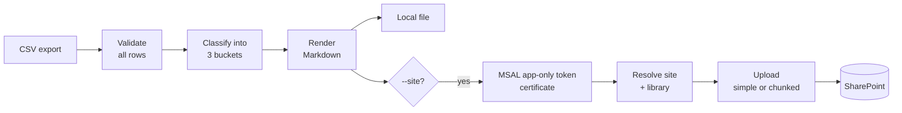

# SharePoint Report Publisher

[](https://github.com/LoganTaylorITGuy/sharepoint-report-publisher/actions/workflows/ci.yml)


Turns a time-tracking CSV export into a **weekly effort report** and publishes it to a
**SharePoint document library** through Microsoft Graph, unattended, with
least-privilege, certificate-based app auth.

```text
$ report-publisher export.csv --staff "Jordan Avery" \
    --site https://contoso.sharepoint.com/sites/Operations --library Reports
wrote weekly_report_2026-W45.md (16h across 10 entries)
published https://contoso.sharepoint.com/sites/Operations/Reports/Weekly/weekly_report_2026-W45.md
```

## Why I built this

In managed services, the hours tell the story of the business: which clients take the
time, how much is billable, and how much goes into internal tooling and learning. That
story usually gets rebuilt by hand from a timesheet export before every quarterly
review.

This tool automates the weekly step. It sorts every entry into one of three buckets,
**Client Work**, **Internal Operations** and **Professional Development**, and files a
consistent Markdown report in SharePoint. From there the reports roll up into quarterly
reviews or feed an AI notebook as an evidence trail. Internal work and learning are reported
as accomplishments, not hidden as overhead.

## What the report looks like

See the full example: **[examples/weekly_report_2026-W45.md](examples/weekly_report_2026-W45.md)**
(generated from the fictional [examples/time_entries.csv](examples/time_entries.csv)).

| Bucket | Hours | % of week |
|---|---|---|
| Client Work | 9h | 56% |
| Internal Operations | 3.5h | 22% |
| Professional Development | 3.5h | 22% |
| **Total** | **16h** | 100% |

## Quick start

```bash
pip install git+https://github.com/LoganTaylorITGuy/sharepoint-report-publisher.git

# Build the report locally (no Microsoft 365 needed)
report-publisher examples/time_entries.csv --week 2026-W45 --staff "Jordan Avery"

# Publish it: see docs/app-registration.md for the 10-minute Entra setup
export GRAPH_TENANT_ID=... GRAPH_CLIENT_ID=... GRAPH_CERT_PATH=... GRAPH_CERT_THUMBPRINT=...
report-publisher export.csv --site https://contoso.sharepoint.com/sites/Operations
```

| Option | Default | |
|---|---|---|
| `--week 2026-W45` | last full ISO week | Handles year boundaries and 53-week years |
| `--staff NAME` | everyone | Filter to one person |
| `--internal-client NAME` | `Internal` | Client name(s) that mean "our own company" (repeatable) |
| `--profdev-category NAME` | `Training`, `Certification`, `R&D` | Internal categories counted as learning (repeatable) |
| `--site URL` | n/a | Paste the SharePoint URL straight from the browser |
| `--library NAME` | site default | Document library display name |
| `--folder PATH` | `Reports/Weekly` | Folder inside the library |

**Input CSV columns:** `Date, Staff, Client, Project, Category, Hours, Billable, Description`.
Extra columns are ignored, and dates can be `YYYY-MM-DD` or `MM/DD/YYYY`.

## How it works



## Engineering decisions

- **Least privilege by default.** The setup guide uses Graph `Sites.Selected`, so the app
  can only write to the one site an admin grants. Most examples online use
  `Sites.ReadWrite.All`, which covers every site in the tenant.
  → [docs/app-registration.md](docs/app-registration.md)
- **Certificate auth first.** A client secret is supported as a fallback for quick tests.
  Credentials come only from environment variables and never appear in errors or logs.
- **Every bad row reported at once.** A broken export reports every problem in one pass,
  with line numbers, so you don't fix one line, rerun, and hit the next.
- **Built for unattended runs.** Retries on `429` / `503`, honours `Retry-After` and backs
  off exponentially. Graph errors are turned into readable messages
  (`GET /sites/… failed (403 accessDenied): …`). Exit codes are distinct (2 = input,
  3 = publish), so a scheduler can alert on the right thing.
- **Large-file safe.** Files over Graph's 4 MB simple-upload limit switch to a chunked
  upload session with correctly sized chunks. The pre-authorised upload URL is called
  *without* a bearer token, as Graph requires.
- **A failed publish never loses the report.** The local file is written first.
- **Small dependency footprint.** `requests` + `msal` instead of the full Graph SDK, so each
  HTTP call is explicit and easy to test.

## Testing

```bash
pip install -e ".[dev]"
pytest          # 63 tests, ~99% coverage, fails under 90%
ruff check . && ruff format --check .
mypy            # strict mode
```

Graph calls are mocked at the HTTP layer with `responses`, and a test fixture blocks real
network access, so the suite can never touch a real tenant. A test also regenerates the
example report and fails if the README's example has drifted from the code. CI runs
everything on Python 3.11, 3.12 and 3.13.

## License

MIT © Logan D Taylor
